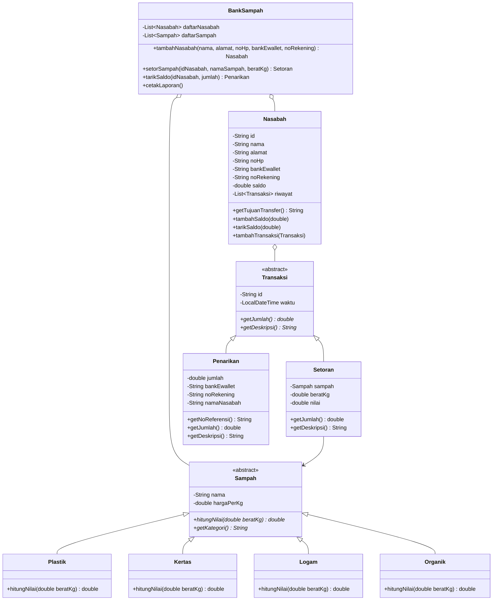

# Bank Sampah Digital

Proyek akhir mata kuliah **Pemrograman Berorientasi Objek (PBO)** menggunakan **Java**.
Aplikasi ini sekarang memiliki **antarmuka GUI (Swing)** untuk memudahkan pengelolaan Bank Sampah: mencatat setoran
sampah warga, mengonversinya menjadi saldo rupiah, dan melakukan **pencairan saldo secara transfer digital** ke rekening/e-wallet nasabah.
Mode CLI tetap tersedia sebagai opsi.

Data disimpan **in-memory** menggunakan `ArrayList`, sehingga data akan hilang saat program
ditutup (tidak memerlukan database).

---

## 1. Latar Belakang Masalah

Pengelola Bank Sampah sering mencatat setoran warga secara manual. Akibatnya:

- Nilai rupiah dari sampah sulit dihitung cepat dan konsisten.
- Saldo tabungan warga rawan salah catat.
- Riwayat setoran/pencairan tidak transparan dan pencairan tunai sulit dilacak.
- Laporan total sampah yang berhasil dikelola tidak tersedia.

Aplikasi ini menyelesaikan masalah tersebut dengan aturan perhitungan otomatis, validasi saldo,
pencairan saldo lewat transfer digital (dengan nomor referensi), riwayat transaksi, dan laporan.

---

## 2. Fitur

| Menu/Tab | Fitur | Keterangan |
|----------|-------|------------|
| 1 | Tambah Nasabah | ID otomatis (`N001`, ...), wajib isi data tujuan transfer (Bank/E-Wallet & No. Rekening/Tujuan) |
| 2 | Lihat Semua Nasabah | Menampilkan data nasabah, rekening tujuan, dan saldo |
| 3 | Setor Sampah | Input jenis sampah + berat, nilai dihitung otomatis |
| 4 | Pencairan Saldo (Transfer) | Saldo ditransfer ke rekening/e-wallet terdaftar, menghasilkan No. Referensi (`TRF001`, ...), ditolak jika saldo tidak cukup |
| 5 | Riwayat Transaksi | Menampilkan setoran & pencairan (termasuk tujuan dan no. referensi) |
| 6 | Laporan | Total kg per kategori, total nilai setoran, total dana dicairkan, saldo beredar |
| 7 | Keluar | Menghentikan program (mode CLI) |

Jenis sampah awal yang tersedia:

| Jenis | Harga / kg | Aturan Nilai |
|-------|-----------|--------------|
| Plastik | Rp4.000 | Bonus 5% jika berat >= 10 kg |
| Kertas | Rp2.500 | Berat x harga |
| Logam | Rp12.000 | Bonus 5% (insentif logam) |
| Organik | Rp1.000 | Berat x harga |

---

## 3. Penerapan 4 Pilar PBO

### a. Encapsulation (Enkapsulasi)

- Field pada `Sampah`, `Nasabah`, dan `Transaksi` bersifat `private`.
- Saldo nasabah **tidak memiliki setter bebas**. Saldo hanya bisa berubah melalui
  `tambahSaldo()` dan `tarikSaldo()` (pencairan) yang memiliki validasi.
- Data rekening tujuan nasabah divalidasi (tidak boleh kosong) saat pendaftaran.
- `getRiwayat()` mengembalikan `Collections.unmodifiableList(...)` agar riwayat tidak bisa
  diubah dari luar.

Contoh: `src/model/Nasabah.java`

```java
private double saldo;

public void tarikSaldo(double jumlah) {
    if (jumlah <= 0) {
        throw new IllegalArgumentException("Jumlah pencairan harus lebih dari 0.");
    }
    if (jumlah > saldo) {
        throw new IllegalArgumentException("Saldo tidak cukup. Saldo saat ini: " + Format.rupiah(saldo));
    }
    saldo -= jumlah;
}
```

### b. Inheritance (Pewarisan)

- `Plastik`, `Kertas`, `Logam`, `Organik` mewarisi `Sampah`.
- `Setoran` dan `Penarikan` (pencairan transfer) mewarisi `Transaksi`.

Contoh: `src/model/Plastik.java`

```java
public class Plastik extends Sampah {
    public Plastik(double hargaPerKg) {
        super("Plastik", hargaPerKg);
    }
}
```

### c. Polymorphism (Polimorfisme)

- `hitungNilai()` di-override berbeda di setiap subclass `Sampah`.
- Objek disimpan sebagai `List<Sampah>` lalu dipanggil secara runtime, sehingga rumus yang
  dipakai menyesuaikan jenis objek sebenarnya.
- `getDeskripsi()` di-override pada `Setoran` dan `Penarikan` (menampilkan detail transfer & no. referensi).

Contoh: `src/service/BankSampah.java`

```java
Sampah sampah = cariSampah(namaSampah);       // bisa Plastik/Kertas/Logam/Organik
Setoran setoran = new Setoran(id, sampah, beratKg);
// Di dalam Setoran, sampah.hitungNilai(beratKg) memakai rumus subclass yang tepat
```

### d. Abstract Class & Abstract Method

- `Sampah` adalah `abstract class` dengan method abstrak `hitungNilai()` dan `getKategori()`.
- `Transaksi` adalah `abstract class` dengan method abstrak `getJumlah()` dan `getDeskripsi()`.

Contoh: `src/model/Sampah.java`

```java
public abstract class Sampah {
    public abstract double hitungNilai(double beratKg);
    public abstract String getKategori();
}
```

---

## 4. Class Diagram



---

## 5. Struktur Folder

```
project/
├── README.md
├── bin/                         (hasil kompilasi .class)
└── src/
    ├── Main.java                (entry point: GUI default, CLI opsional)
    ├── BankSampahGUI.java       (antarmuka GUI Swing)
    ├── BankSampahCLI.java       (antarmuka CLI lama)
    ├── model/
    │   ├── Sampah.java          (abstract)
    │   ├── Plastik.java
    │   ├── Kertas.java
    │   ├── Logam.java
    │   ├── Organik.java
    │   ├── Nasabah.java
    │   ├── Transaksi.java       (abstract)
    │   ├── Setoran.java
    │   └── Penarikan.java       (pencairan/transfer saldo)
    ├── service/
    │   └── BankSampah.java      (logika bisnis + koleksi data)
    └── util/
        └── Format.java          (format Rupiah & angka)
```

---

## 6. Workflow Aplikasi

### Alur saat program dijalankan

1. `Main` menjalankan `BankSampahGUI.launch()` (default) atau `BankSampahCLI` jika diberi argumen `--cli`.
2. GUI/CLI membuat objek `BankSampah`.
3. Konstruktor `BankSampah` mengisi daftar jenis sampah awal (Plastik, Kertas, Logam, Organik).
4. Pengguna mengelola nasabah, setoran, pencairan saldo (transfer), riwayat, dan laporan.

### Alur Tambah Nasabah

```
Input nama, alamat, no HP, bank/e-wallet, no. rekening/tujuan
        |
        v
Validasi field wajib (nama, bank/e-wallet, no. rekening)
        |
        v
Nasabah dibuat dengan ID otomatis + saldo 0
```

### Alur Setor Sampah

```
Input ID nasabah + jenis sampah + berat
        |
        v
BankSampah.setorSampah()
        |
        +--> cariNasabah()  (validasi ID)
        +--> cariSampah()   (validasi jenis)
        +--> new Setoran(...)
        |         |
        |         +--> sampah.hitungNilai(berat)  <-- polymorphism
        |
        +--> nasabah.tambahSaldo(nilai)           <-- enkapsulasi saldo
        +--> nasabah.tambahTransaksi(setoran)     <-- riwayat
        |
        v
Tampilkan nilai setoran + saldo terbaru
```

### Alur Pencairan Saldo (Transfer Digital)

```
Input ID nasabah + jumlah + konfirmasi
        |
        v
BankSampah.tarikSaldo()
        |
        +--> nasabah.tarikSaldo(jumlah)
        |         |
        |         +--> validasi jumlah > 0
        |         +--> validasi jumlah <= saldo
        |
        +--> generateNoReferensi() -> TRFxxx
        +--> new Penarikan(ref, jumlah, bank, norek, nama)
        +--> simpan ke riwayat nasabah
        |
        v
Tampilkan no. referensi, tujuan transfer, jumlah, saldo terbaru
```

### Alur Laporan

1. Iterasi seluruh nasabah dan seluruh transaksinya.
2. Transaksi setoran dijumlahkan beratnya per kategori (`getKategoriSampah()`).
3. Total nilai setoran, total dana dicairkan, jumlah pencairan, dan total saldo beredar dihitung.
4. Hasil ditampilkan (GUI/CLI).

---

## 7. Cara Kompilasi dan Menjalankan

Prasyarat: **JDK 8 atau lebih baru** sudah terpasang.

Buka PowerShell di folder proyek, lalu jalankan:

```powershell
javac -d bin -sourcepath src src/Main.java src/BankSampahGUI.java src/BankSampahCLI.java
java -cp bin Main
```

- `java -cp bin Main` : membuka **GUI** (default)
- `java -cp bin Main --cli` : menjalankan mode **CLI**

> Jika `javac` dan `java` berbeda versi dan muncul `UnsupportedClassVersionError`, kompilasi dengan target Java 8:
> ```powershell
> javac --release 8 -d bin -sourcepath src src/Main.java src/BankSampahGUI.java src/BankSampahCLI.java
> java -cp bin Main
> ```
> (Pada JDK terbaru bisa muncul warning obsolete options, tetapi aman diabaikan.)

Alternatif: buka folder proyek di IntelliJ IDEA / NetBeans / Eclipse, tandai `src` sebagai
source root, lalu jalankan `Main.java`.

---

## 8. Skenario Demo (untuk Presentasi)

Urutan input yang bisa dicoba:

| Langkah | Menu/Tab | Input | Hasil yang Diharapkan |
|---------|----------|-------|------------------------|
| 1 | Tambah Nasabah | Nama: `Budi`, Alamat: `Jl. Mawar`, No HP: `08123`, Bank/E-Wallet: `BCA`, No. Rekening: `1234567890` | Nasabah `N001` dibuat dengan tujuan transfer `BCA 1234567890 a.n. Budi` |
| 2 | Setor Sampah | ID: `N001`, Jenis: `Plastik`, Berat: `12` | Nilai `Rp50.400` (12 x 4.000 + bonus 5%), saldo `Rp50.400` |
| 3 | Pencairan Saldo | ID: `N001`, Jumlah: `20000`, Konfirmasi: `Ya` | Transfer berhasil, No. Referensi `TRF001`, saldo menjadi `Rp30.400` |
| 4 | Pencairan Saldo | ID: `N001`, Jumlah: `100000` | Ditolak: saldo tidak cukup |
| 5 | Riwayat Transaksi | ID: `N001` | Tampil setoran dan transfer (tujuan + Ref: TRF001) |
| 6 | Laporan | - | Total setoran, total dana dicairkan, saldo beredar, total kg per kategori |

Contoh output pencairan berhasil (CLI):

```
Pencairan berhasil diproses!
No. Referensi : TRF001
Tujuan        : BCA 1234567890 a.n. Budi
Jumlah        : Rp20.000
Saldo sekarang: Rp30.400
```

Contoh output pencairan yang ditolak:

```
Gagal mencairkan saldo: Saldo tidak cukup. Saldo saat ini: Rp30.400
```

---

## 9. Aturan Validasi

- Nama nasabah, Bank/E-Wallet, dan No. Rekening/Tujuan tidak boleh kosong.
- Berat sampah harus lebih dari 0 kg.
- Jumlah pencairan harus lebih dari 0 dan tidak melebihi saldo.
- Saldo tidak pernah bernilai negatif.
- ID nasabah dan jenis sampah harus terdaftar.
- Setiap pencairan diproses sebagai transfer digital dengan nomor referensi unik.
- Input angka yang salah akan ditolak dan diminta ulang (program tidak crash).

---

## 10. Cara Menambah Jenis Sampah Baru

Untuk menunjukkan bahwa desain mudah dikembangkan:

1. Buat file baru di `src/model/`, misalnya `Kaca.java`:

   ```java
   package model;

   public class Kaca extends Sampah {
       public Kaca(double hargaPerKg) {
           super("Kaca", hargaPerKg);
       }

       @Override
       public double hitungNilai(double beratKg) {
           validasiBerat(beratKg);
           return beratKg * getHargaPerKg() * 1.02;
       }

       @Override
       public String getKategori() {
           return "Anorganik - Kaca";
       }
   }
   ```

2. Daftarkan di `seedJenisSampah()` pada `src/service/BankSampah.java`:

   ```java
   daftarSampah.add(new Kaca(3000));
   ```

3. Kompilasi ulang. Jenis sampah baru langsung bisa dipakai tanpa mengubah logika transaksi.

---

## 11. Catatan

- Data hanya tersimpan di memori. Jika ingin data permanen, pengembangan berikutnya bisa
  menambahkan penyimpanan file `.csv`/`.txt` atau database (JDBC).
- Pencairan saldo dicatat sebagai transfer digital (simulasi) ke rekening/e-wallet nasabah dengan nomor referensi sebagai bukti transaksi.
- Format Rupiah menggunakan `Locale` Indonesia sehingga tampil seperti `Rp4.000`.
- Proyek tidak memakai library eksternal, cukup JDK standar.